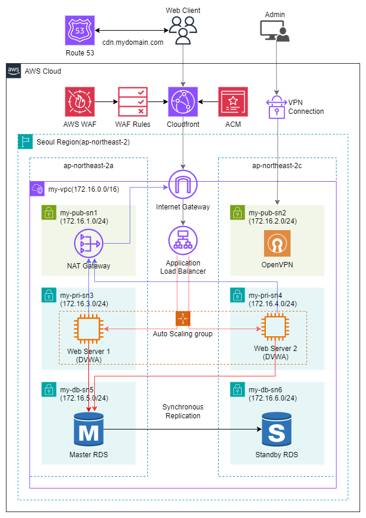

# 주제: AWS WAF와 CloudFront를 이용한 안정적인 웹 서비스 구현
> [!NOTE]
> **프로젝트 기간:** 2026.11.02 / **난이도:** ★★★☆☆
>
## 프로젝트 구성도

## 프로젝트 목표
- AWS 기본 자원을 생성할 수 있다.
- AWS Cloudfront를 이용한 CDN 배포 서비스를 구현할 수 있다.
- AWS WAF로 보안이 강화된 안정적인 웹 서비스를 구현할 수 있다.
